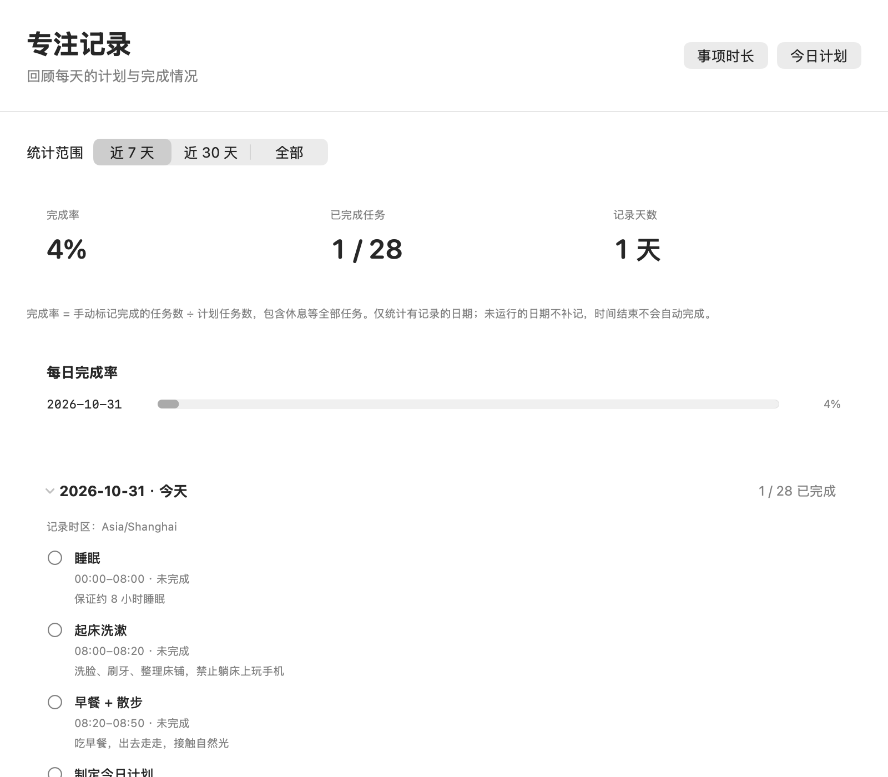

# FocusDesk

[简体中文](README.md) | **English**

[](https://github.com/whathaventggood/FocusDesk/actions/workflows/ci.yml)

A native desktop focus manager for Apple Silicon Macs, built with Swift, SwiftUI, AppKit, and local JSON storage. Requires macOS 13 or later. No server, database, or third-party dependencies. The app interface and built-in schedule are currently in Simplified Chinese.

[Installation](docs/INSTALL.md#english) · [Changelog](CHANGELOG.md) · [Release process](docs/RELEASING.md) · [GitHub Releases](https://github.com/whathaventggood/FocusDesk/releases)

## Screenshots

### Desktop square

A small 56-point square stays on the desktop. Hover to expand a 360 × 500-point task details panel, move into the details to keep them open, and move outside both areas to collapse. A short motivational quote appears at the bottom, with a small “解释与出处” link to its explanation and source.


### Task details and settings

| Expanded task details | Settings |
| :---: | :---: |
|  |  |

### Today's plan

Browse the full day in start-time order. Edit, add, delete, and mark tasks complete in the same window.


### Focus history

Review completion rates by date and each day's task snapshot.



## Usage

- **Desktop square:** drag to move, or drag the bottom-right corner to resize. The default size is 56 points; Settings allows 32–112 points. Size and position persist. Hover expansion does not take keyboard focus.
- **Current task:** shows its time range, title, details, remaining time, elapsed-time progress, and next task. Gaps show “自由时间” (free time). Elapsed-time progress is separate from completion.
- **Motivational quotes:** the expanded panel randomly selects from 20 Chinese quotes included with the app. The quote updates every hour without consecutive repeats. Restarting within the same period preserves the quote; waking after a long sleep refreshes it according to the actual time. A small “解释与出处” link opens an independent window with an explanation and attribution. Quotes and details work offline and can be [customized](#customize-quotes).
- **Today's plan:** click a task card or pencil to edit its time, title, and details in place. “完成并保存” (save, ⌘S) persists the change and updates the desktop view. Viewing and editing share one management window.
- **Conflict handling:** new tasks prefer available gaps. A fully booked day still allows an empty-time draft. Overlaps list the affected tasks and available gaps. Change the time, use a suggested gap, or preview replacing the occupied interval while preserving uncovered portions of the original tasks. Replacement requires explicit confirmation before atomic saving.
- **Completion:** manually check or uncheck tasks; completion survives restart. Reaching an end time never automatically marks a task complete.
- **History:** inspect the last 7 days, 30 days, or all recorded days. Completion rate is completed task count divided by planned task count, including breaks and sleep. Range totals are weighted by total task count, rather than averaging daily percentages. Days without records are omitted rather than recorded as zero.
- **Daily schedule:** repeats each day. Today's edits update today's snapshot. Past task names, times, and completion states retain their snapshots. Day changes and wake events recalculate from the actual local date and system clock.
- **Menu bar:** show or hide the desktop component, open the plan, focus history, and settings, or quit. The app has no Dock icon and keeps running when management windows close.
- **Settings:** always on top and launch at login. Login startup uses `SMAppService.mainApp`; install the app in a stable location and enable it yourself.

Times use 24-hour `HH:mm` format. End time must be later than start time; an end of `00:00` means the end of the day (24:00). Zero duration, malformed time, empty titles, and unconfirmed overlaps are rejected. Adjacent tasks may share a boundary. First launch includes 28 study and daily-life tasks.

## Install and update

Download a ZIP from [Releases](https://github.com/whathaventggood/FocusDesk/releases), check that version's signing disclosure and SHA-256, extract it, and move `FocusDesk.app` into Applications. See [installation instructions](docs/INSTALL.md#english) for first launch, system warnings, updates, and backup.

Local builds and CI previews use **ad-hoc signing, which is not Developer ID signing or Apple notarization**. Each release discloses its actual status. Optional Developer ID signing and notarization are supported; without configured credentials, the workflow can prepare a clearly labeled community-build draft.

## Run from Xcode

1. Install full Xcode 15 or later, open it, and finish installing its components.
2. Open `FocusDesk.xcodeproj`, select **FocusDesk → My Mac**, and press **⌘R**.
3. If prompted about signing, choose **Sign to Run Locally** or your development team.
4. Press **⌘U** to run `FocusDeskTests` in the shared scheme.

The project uses Swift 5 language mode and targets macOS 13. Run the actual desktop app from `.xcodeproj`; `Package.swift` is only for headless model and persistence tests.

## Customize quotes

### Edit the content and style

Open [FocusDesk/Models/MotivationalQuote.swift](FocusDesk/Models/MotivationalQuote.swift) and edit each entry's `text` in `MotivationalQuote.all`. You can use poetry, quotations, or a mixture of Chinese and Western sources. For example:

```swift
.init(id: "small-step", text: "天行健，君子以自强不息。",
      explanation: "自然运行刚健不息，君子也应不断进取。",
      source: "《周易·乾卦·象传》"),
```

- Keep the existing `id` when replacing text. Give new entries unique IDs. Text must be nonempty and should not be duplicated across entries.
- Use `explanation` for the explanation and `source` for the author and work; both appear in the detail window. Escape double quotes as `\"`, newlines as `\n`, and backslashes as `\\`. Keep entries short and check how they fit in the hover panel.
- The catalog currently has 20 entries. If adding or removing entries, keep at least two so rotation can exclude the previous quote. Update the expected count in `XCTAssertEqual(MotivationalQuote.all.count, 20)` in [MotivationalQuoteTests.swift](FocusDeskTests/MotivationalQuoteTests.swift), then run the tests.

### Why does the old text still appear?

**Quotes are compiled into the app, rather than loaded from an external text file at runtime.** Saving the Swift file, hovering again, or clearing the cache cannot update an existing app build. Rebuild and launch the new app:

1. Choose **退出** (Quit) from FocusDesk's menu bar menu. Closing the plan window or hiding the square does not quit the app. If running from Xcode, stop the previous run too.
2. Save your edits, open a terminal in the project root, and run the following. It opens the newly built app only if the build succeeds:

   ```sh
   ./scripts/build-app.sh Release && open "$PWD/build/Release/FocusDesk.app"
   ```

3. Hover over the square to check the quote. Alternatively, after quitting the old app, press **⌘R** in Xcode to rebuild and run.

If you normally use the installed app, quit it, copy the new `build/Release/FocusDesk.app` into `/Applications` to replace the old copy, and open it. Building the project does not update the installed copy. An old shortcut or login item may otherwise launch the previous build again.

The one-hour cache stores only the selected **`id` and selection time**, not the text. Changing the selected entry's `text` while keeping its `id` takes effect as soon as you launch the new build; **there is no one-hour wait**. If you edited other entries, the currently selected quote may remain unchanged. To inspect the cached `id`, run:

```sh
defaults read com.focusdesk.FocusDesk 'motivationalQuote.v1'
```

### Reset the quote selection

To draw a quote again immediately, first **quit FocusDesk** through its menu bar menu, then run:

```sh
defaults delete com.focusdesk.FocusDesk 'motivationalQuote.v1'
```

Open the app containing your new quotes. For the local build above, run this from the project root:

```sh
open "$PWD/build/Release/FocusDesk.app"
```

This removes only the quote selection and timing cache. Tasks, history, and window settings are unaffected; do not delete `plan.json`. If the command reports that the key does not exist, there is no cached selection and you can open the app. A reset forgets the previous quote, so the random draw may pick the same one again. A new one-hour period starts at selection time. Quit before resetting so the running app cannot write the cache again.

## Build and package

Command Line Tools can build the local arm64 app:

```sh
./scripts/build-app.sh Release
```

Outputs: `build/Release/FocusDesk.app`, `FocusDesk.zip`, and `SHA256SUMS.txt`. This is an ad-hoc signed, unnotarized local build. The script does not launch the app or register login items.

With full Xcode, run real XCTest and produce a versioned candidate:

```sh
./scripts/package-release.sh
```

Outputs in `build/release/` include `FocusDesk-2.2.0-arm64.zip`, SHA-256, installation instructions, and release notes. Failing tests prevent packaging. You can also archive through **Product → Archive**. See the [release process](docs/RELEASING.md) for distribution signing, notarization, and draft review.

### Build error: a module is defined twice

If `module '_DarwinFoundation1' is defined in both ...` lists paths differing only in casing, such as `Desktop` and `desktop`, the compiler cache contains two spellings of the same directory. Build scripts now normalize the actual path with the system `/bin/pwd -P`, but existing caches need a one-time cleanup.

Once no build is running, run this from the project root:

```sh
rm -rf ./build/ModuleCache
./scripts/build-app.sh Release
```

This removes only regenerable compiler caches, leaving source code, quote content, tasks, and history intact. It is separate from the one-hour quote cache; `defaults delete` is not needed. After a successful build, quit the old app and open the newly generated `build/Release/FocusDesk.app`.

## Tests and CI

```sh
./scripts/test-xcode.sh
```

This executes `xcodebuild build test` against the app-hosted XCTest target and preserves `build/TestResults/*.xcresult` and logs. Test environments use project-local data and in-memory preferences to protect everyday plans. With only Command Line Tools the script fails explicitly; smoke checks do not stand in for XCTest.

Tests cover time matching and boundaries, remaining time, free time, midnight, input validation, conflict replacement, completion and undo, date changes, historical snapshots, legacy JSON migration, atomic persistence, corrupt-file protection, and quote rotation across one-hour boundaries, restarts, sleep, clock corrections, and malformed caches.

GitHub Actions runs the same Xcode tests for `main` pushes, pull requests, and manual dispatches, retaining reports, logs, and an arm64 preview ZIP. A version tag triggers the release workflow; only successful tests allow creation of a **draft release**, which a maintainer reviews before publishing. Check the actual Actions result and XCTest report for the exact commit to confirm whether tests passed.

Foundation checks, native-window checks, and local app builds provide additional validation. They do not replace app-hosted XCTest run with full Xcode or in CI.

Optional checks:

```sh
bash scripts/check-core.sh
bash scripts/check-native.sh
```

Native checks require a desktop session with WindowServer access; use `bash scripts/check-native.sh --build-only` to compile without opening test windows. Cross-app hovering, dragging, resizing, quote display, and actual sleep/wake still need manual acceptance testing.

## Data and backup

```text
~/Library/Application Support/FocusDesk/plan.json
```

One versioned JSON document atomically stores the repeating plan and daily history. Legacy task-array files migrate on the first successful save. Back up before upgrading; downgrading requires restoring a compatible backup. Current-day edits reconcile today's snapshot, while past snapshots remain unchanged.

Unreadable data is backed up and saving stops with a recovery message, protecting history from silent replacement. Window position, size, and always-on-top preferences use the `com.focusdesk.FocusDesk` UserDefaults domain. macOS stores the login-item state. The selected quote's `id` and selection time are cached under the `motivationalQuote.v1` UserDefaults key. Quote text is compiled into the app, not stored in the cache or `plan.json`; tasks and completion history are unaffected. There is no server and plans are not uploaded.

Developers can set `FOCUSDESK_DATA_DIRECTORY` to override the JSON directory. Compiler caches, test reports, and script temporary files remain inside the project's `build/` directory. See [installation instructions](docs/INSTALL.md#english) for backup and recovery.

## Project structure

```text
FocusDesk/
  App/          Entry point, NSPanels, menu bar, and management windows
  Models/       Tasks, validation, conflict replacement, daily snapshots
  Services/     Scheduling, atomic JSON persistence, system integration
  Views/        Square, details, inline plan editor, history, settings
  Resources/    Info.plist
FocusDeskTests/ XCTest
FocusDesk.xcodeproj/
Package.swift   Headless logic-test entry point
scripts/        Build, Xcode test, and release-candidate scripts
.github/workflows/ CI and draft releases
CHANGELOG.md
docs/           Installation, release instructions, screenshots
```
