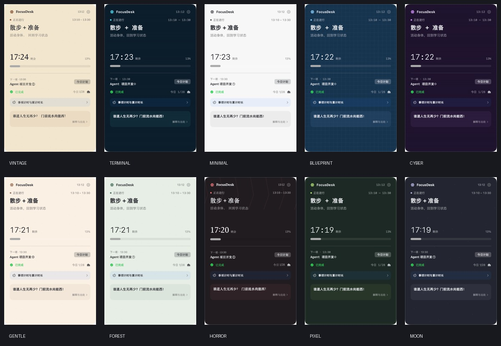
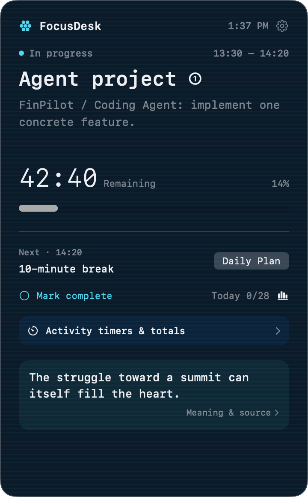
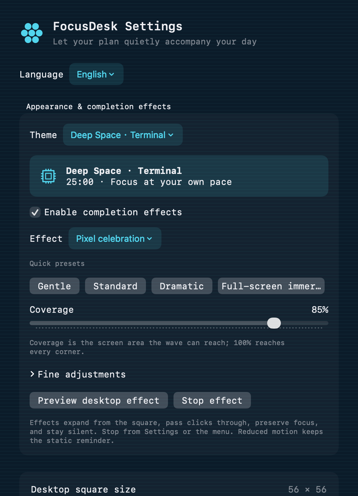
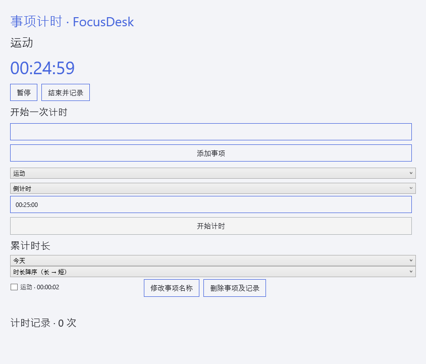
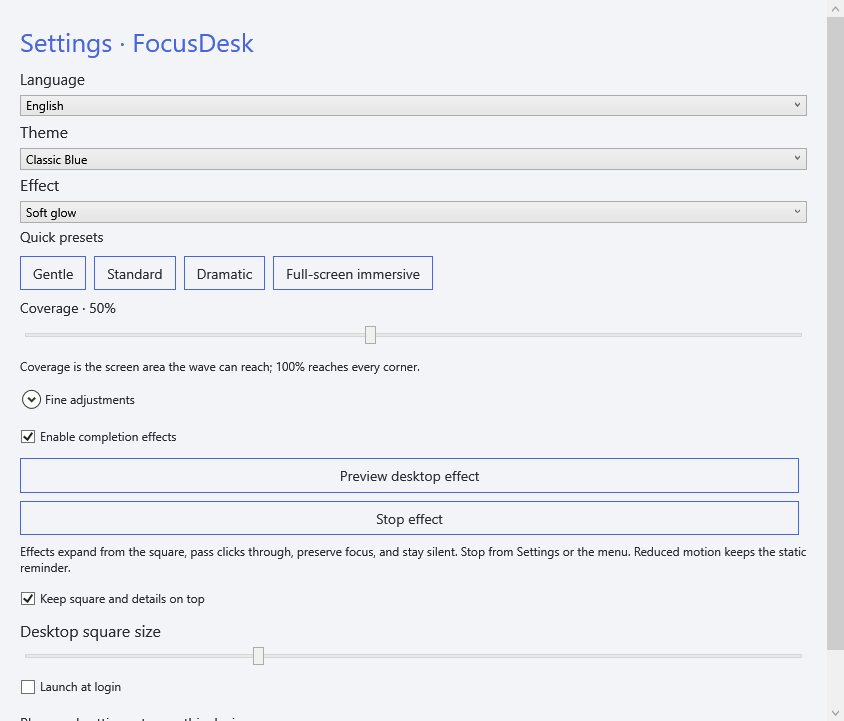
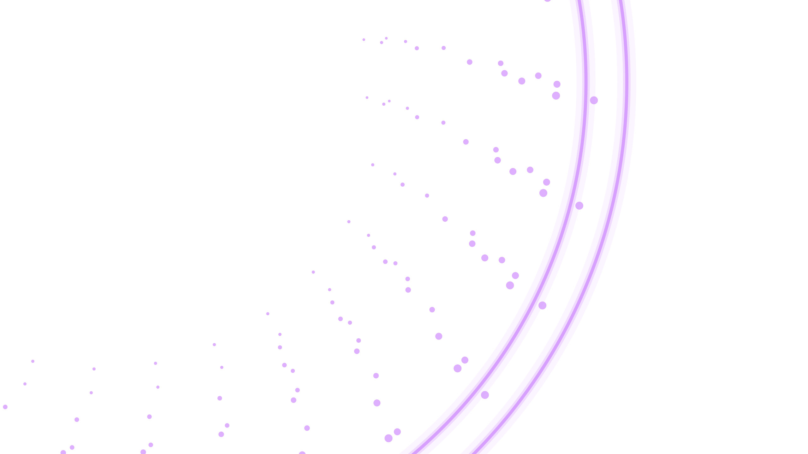

# FocusDesk

[简体中文](README.md) | **English**

A local-first focus companion for **macOS and Windows**. Keep a small desktop square visible; hover to see your daily plan or current activity timer. Plans, history, timers, themes, and language preferences remain on each device. **No account, server, or cross-device personal-data sync.**

[Download a release](https://github.com/whathaventggood/FocusDesk/releases/latest) · [Changelog](CHANGELOG.md) · [Installation](docs/INSTALL.md) · [Release process](docs/RELEASING.md)

## Downloads

Version 3.1.0 has four packages. Both language editions contain the same features and allow switching between English and Simplified Chinese in Settings. The package language only sets the initial default; existing preferences and user content are preserved.

| System | English default | Simplified Chinese default |
|---|---|---|
| macOS 13+, Apple Silicon | `FocusDesk-3.1.0-macos-arm64-en.zip` | `FocusDesk-3.1.0-macos-arm64-zh-Hans.zip` |
| Windows 10/11, x64 | `FocusDesk-3.1.0-windows-x64-en.zip` | `FocusDesk-3.1.0-windows-x64-zh-Hans.zip` |

Check the actual release assets and test results. On Windows, extract the entire archive and launch `FocusDesk.exe`; the .NET runtime is included. Keep all accompanying files together. On Mac, extract and move `FocusDesk.app` into Applications. Quit the previous version and back up local data before upgrading.

Community builds are ad-hoc signed and not Apple notarized on Mac, and do not have a commercial Windows code-signing certificate. The operating system may display publisher-verification prompts. See the installation guide; do not disable system security protections.

## Screenshots



| English desktop | English settings |
|---|---|
|  |  |

Images are rendered from the actual applications. Browse [all screenshots](docs/screenshots/) for Windows and other themes.

| Windows 中文版 | Windows English |
|---|---|
|  |  |

## Features and platform parity

| Feature | macOS | Windows |
|---|---|---|
| Desktop square, hover details, drag, resize, always-on-top | Yes | Yes |
| Repeating daily plan, editing, confirmed conflict replacement | Yes | Yes |
| Manual completion and daily history snapshots | Yes | Yes |
| Named activities, stopwatch, countdown, pause and resume | Yes | Yes |
| Persistent completion state, finish, five more minutes, restart recovery | Yes | Yes |
| Activity totals, date ranges, sorting, selected-activity sums | Yes | Yes |
| 11 palettes, 10 effects, screen coverage, fine controls, preview | Yes | Yes |
| English and Simplified Chinese UI, examples, and quotes | Yes | Yes |
| System entry point | Menu bar, ⌘1/2/3 | System tray |
| Task drafts and detailed inline replacement preview | Yes | Dialog editing and replacement confirmation |
| History filters | 7 / 30 days and all time | 7 / 30 days and all time |

Both apps use shared translations, initial plans, and quote resources from `shared/`. Timer rules are consistent: paused time is excluded, countdowns stop accumulating at their target, waiting after completion is excluded, and running timers recover elapsed time after sleep or exit. “+5 minutes” starts a new five-minute stretch at click time for the same activity.

Language changes translate the interface, not personal task or activity names. Initial example plans use the selected language when data is first created. Switching languages never rewrites an existing plan.

## Using FocusDesk

- **Desktop:** the square defaults to 56 points and supports 32–112. Hover to expand; leave both panels to collapse. Drag to move, or use the bottom-right handle to resize. Hover does not take keyboard focus.
- **Daily plan:** use `HH:mm` in 24-hour time. An end of `00:00` or `24:00` means midnight. Split overnight tasks into two parts. Confirm conflicting replacements before saving; unaffected fragments are retained.
- **Timers:** open Activity Timers from the menu bar or tray. Only one timer can remain active. Completion is silent and keeps a pending reminder until you finish or extend it. Finish returns the desktop to the daily plan.
- **Appearance:** select any theme and effect independently. Choose Gentle (15%), Standard (50%), Dramatic (85%), or Full-screen immersive (100%). Adjust coverage from 10–100%, opacity, 1–12 second total duration, expansion speed, 1–3 waves, particle density, edge glow, and background dimming independently. Preview at actual desktop size; use Stop effect in Settings or the tray/menu bar to dismiss immediately. All monitors is optional and off by default. Effects pass clicks through, preserve focus, and respect system reduced-animation settings. Native rendering differs slightly by platform.
- **Language:** use `Language / 语言` in Settings. Dates follow the interface locale and local clock.
- **History:** completion rate is manually completed tasks divided by all planned tasks, including breaks. Time passing never marks tasks complete. Unrecorded dates are not invented.
- **Quit:** closing management windows leaves the app running. Quit from the menu bar or system tray.

## Screen effects in 3.1



Coverage measures the screen area reached by the expanding circle at its largest extent, including when the square sits in a corner. It does not mean that percentage of the screen is opaque. The animation has a brief origin glow, broad expanding bands with theme-specific particles, and an optional edge-light finish. Edge glow is part of the total duration and capped at 40% of it. Turning effects off immediately stops an active animation. The default target is the square’s monitor; All monitors adds a separate overlay to each display, starting from the nearest point to the square on other displays. No screen recording permission is needed.

The same controls and presets are available on both systems. Existing intensity choices migrate to the corresponding new presets; manual adjustments persist. Effects stay silent, pass clicks through, and honor reduced motion. Desktop effects may be limited by OS-protected screens or exclusive full-screen applications. Mixed-DPI and multi-monitor placement still need testing on more physical setups.

## Local data and privacy

| System | Data location |
|---|---|
| macOS | `~/Library/Application Support/FocusDesk/plan.json` and `timers.json`; preferences in app UserDefaults |
| Windows | `%LOCALAPPDATA%\FocusDesk\desktop.json` |

Each platform has its own local storage format. There is no automatic import or synchronization between devices. Writes validate data before atomic replacement. Damaged files are backed up and protected from overwrite. Quit before backing up. Windows `default-language.txt` contains only the first-run language, never personal data.

## Build and test

Mac, with Xcode 15+:

```sh
python3 scripts/localization/generate.py
./scripts/test-xcode.sh
FOCUSDESK_DEFAULT_LANGUAGE=en ./scripts/build-app.sh Release
```

With Command Line Tools only, `scripts/check-core.sh`, `scripts/check-native.sh`, and `scripts/build-app.sh` provide supplemental checks and builds, not XCTest. Native checks use isolated data and save screenshots in `build/native-smoke/`.

Windows, with .NET 8 SDK:

```powershell
dotnet publish windows/FocusDesk.Windows -c Release -r win-x64 --self-contained true -o build/windows-publish
build/windows-publish/FocusDesk.exe --self-test
build/windows-publish/FocusDesk.exe --smoke
```

Self-tests cover timers, totals, rollback, and corruption protection. Smoke mode renders both languages and all themes into `build/windows-screenshots/` using temporary data; it does not register startup or change everyday data.

GitHub Actions **Desktop parity** tests and packages both platforms on their actual operating systems. Release assets are uploaded after both platforms pass, with SHA-256 checksums. Automated UI rendering does not cover every GPU, DPI, monitor arrangement, or real mouse interaction.

## Source layout

- `FocusDesk/`: native SwiftUI / AppKit Mac app.
- `windows/FocusDesk.Windows/`: native WPF / .NET 8 Windows app.
- `shared/`: translations, initial task templates, and 20 quotes.
- `scripts/localization/generate.py`: translation coverage and placeholder validation; generated Swift localization.
- `FocusDeskTests/`, `scripts/check-*.swift`: Mac tests and isolated native checks.
- `.github/workflows/`: desktop checks, packaging, and releases.

There is no mobile version or network synchronization of personal data.
