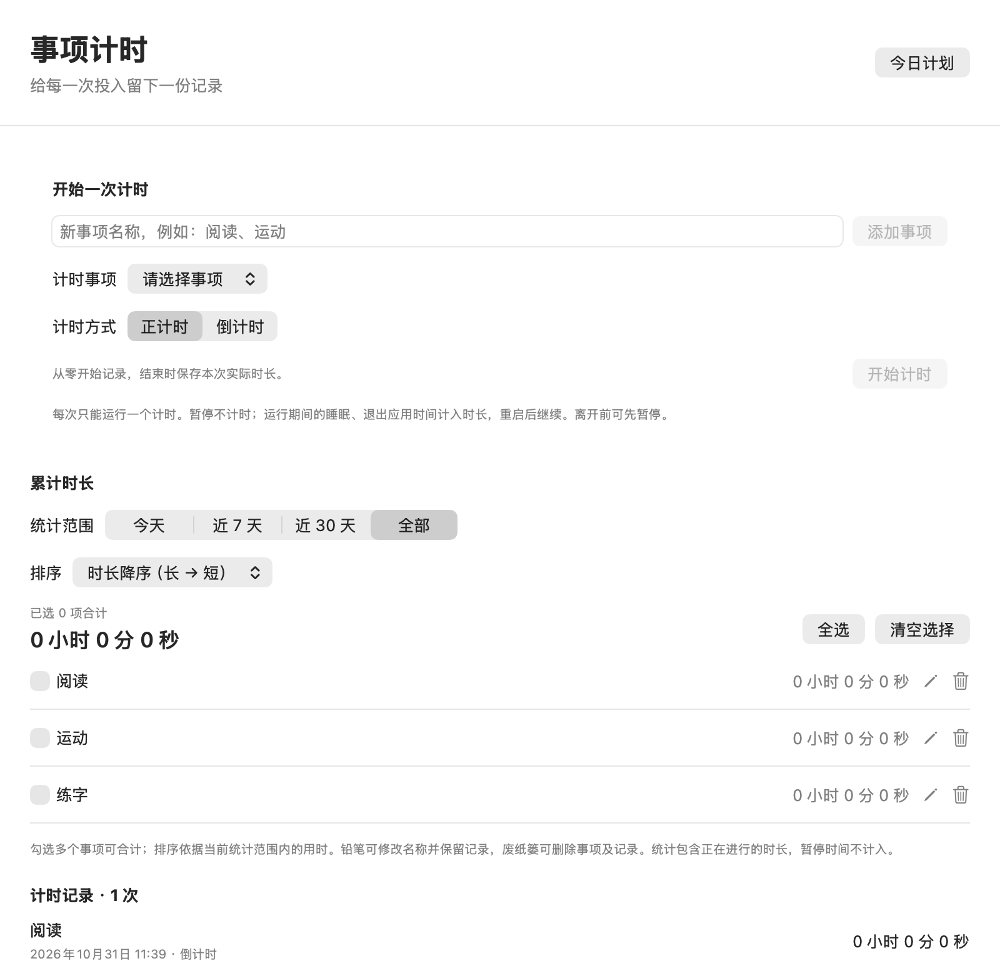

# FocusDesk

**简体中文** | [English](README.en.md)

[](https://github.com/whathaventggood/FocusDesk/actions/workflows/ci.yml)

面向 Apple Silicon Mac 的原生桌面专注管理应用，使用 Swift、SwiftUI、AppKit 和本地 JSON。最低系统为 macOS 13，不需要服务器、数据库或第三方依赖。

[下载安装](docs/INSTALL.md) · [版本记录](CHANGELOG.md) · [发布流程](docs/RELEASING.md) · [GitHub Releases](https://github.com/whathaventggood/FocusDesk/releases)

## 界面展示

### 桌面小方块

平时只保留一个小方块，默认边长 56 点。鼠标移入自动展开 360 × 580 点的任务详情面板，移入详情区域会保持展开；离开方块和详情后自动收起。面板底部展示简短励志语句，点击小巧的“解释与出处”入口可阅读详情。


### 任务详情与设置

| 展开的任务详情 | 设置 |
| :---: | :---: |
|  |  |

### 今日计划

按开始时间浏览全天任务，在同一窗口中原位编辑、新增、删除和标记完成。


### 专注记录

按日期查看任务完成率和当天的任务快照。


### 事项计时与累计时长

自定义阅读、运动等事项，选择正计时或倒计时，暂停续计，并按事项和日期范围统计累计时长。



## 使用

- **桌面组件**：拖动方块移动位置，拖动右下角调节大小。默认 56 点，设置中可调为 32–112 点，位置和大小自动记忆。悬停展开不主动抢夺键盘焦点。
- **当前任务**：显示时间段、标题、详细说明、剩余时间、时间进度和下一项任务。未安排任务时显示“自由时间”；时间进度只代表时间流逝，不代表任务完成。
- **事项计时（2.3.0）**：从菜单栏的“事项计时…”、快捷键 ⌘3 或悬停面板入口打开。添加阅读、运动等自定义事项，选择正计时或设定时长倒计时（1 秒至 7 天），支持暂停、继续和提前结束；倒计时到点自动结束并记录，应用运行时发出提示音，并显示完成提示。每次仅运行一个计时；暂停后需结束当前计时才能切换事项。
- **事项管理（2.3.1）**：在累计时长列表点铅笔修改名称并保留原记录；点废纸篓删除事项。删除前显示确认，确认后该事项的全部记录和累计时长会清除，运行或暂停中的计时也一并停止，其他事项保留。
- **累计时长**：同一事项的多次正计时和倒计时自动累计，可查看今天、近 7 天、近 30 天及全部记录，勾选多个事项计算合计，支持按当前统计范围的用时升序（短到长）或降序（长到短），时长相同按添加顺序排列。统计包含当前正在进行的时长，跨日按实际发生时间拆分，暂停时间不计入。运行期间的睡眠和退出应用时间计入时长，重启后继续；离开前可先暂停。
- **励志语句**：悬停详情底部从 20 句内置中文语录中随机选择一句，每小时更新，避免相邻两次重复。重启后同一周期保留原句；长时间睡眠后按实际时间刷新。卡片仅显示语句与小巧的“解释与出处”入口，点击可在独立窗口阅读释义及作者、作品来源。语录和详情均离线可用，也可[自行修改语录](#自定义语录)。
- **今日计划**：点击任务卡片或铅笔图标，在原位置修改时间、名称和说明，点击“完成并保存”（⌘S）保存并同步悬浮窗。新增、编辑、删除均在同一管理窗口完成。
- **新增冲突处理**：有空闲时段时优先填入可用时间；全天排满时也能打开新增表单。与已有任务冲突时列出受影响任务，允许修改时间，或确认替换占用时段；替换会保留原任务未被覆盖的前后片段。确认前不改动原计划。
- **今日完成情况**：在任务旁手动勾选完成或撤销，保存后重启仍保留。时间到了不会自动标记完成。
- **专注记录**：查看近 7 天、近 30 天或全部历史，展示每日完成率及任务快照。完成率为已手动完成的任务数 ÷ 计划任务总数，包含睡眠和休息任务；区间完成率按总任务数计算，不是每日百分比的简单平均。没有记录的日期不补记为零。
- **每日作息**：计划每天重复。当前日期的计划修改会同步到今日记录，过去日期的任务名称、时间和完成状态保留快照，不随新计划变化。跨日及睡眠唤醒后按实际本地日期和系统时间更新。
- **菜单栏**：可显示/隐藏桌面组件，打开今日计划、事项计时、专注记录和设置，或退出。应用不占 Dock 图标，关闭管理窗口后继续在菜单栏运行。
- **设置**：开关始终置顶、登录时启动。登录启动使用 macOS 的 `SMAppService.mainApp`，需将应用放在固定目录后由用户主动开启。

时间使用 `HH:mm` 24 小时制。结束时间必须晚于开始时间；结束时间 `00:00` 表示当天结束（24:00）。禁止零时长、无效时间、空名称和未经确认的重叠时段；相邻任务可共用边界。首次启动内置 28 项学习与生活任务。

## 安装与更新

从 [Releases](https://github.com/whathaventggood/FocusDesk/releases) 下载 ZIP，核对该版本签名说明和 SHA-256，解压后将 `FocusDesk.app` 放入“应用程序”。首次打开、系统提示、更新和备份步骤见 [安装说明](docs/INSTALL.md)。

普通本地构建及 CI 预览使用临时签名（ad-hoc），**不等于 Developer ID 签名或 Apple 公证**。Release 页面会写明实际签名状态；不要仅凭版本号判断。仓库提供可选 Developer ID + 公证流程，证书尚未配置时仍可生成明确标注的社区构建草稿。

## 从 Xcode 运行

1. 安装完整 Xcode 15 或更新版本，首次打开并完成其组件安装。
2. 打开 `FocusDesk.xcodeproj`，选择 **FocusDesk → My Mac**，按 **⌘R**。
3. 若出现签名提示，将本机开发签名设为 **Sign to Run Locally**，或选择自己的开发团队。
4. 按 **⌘U** 运行共享 scheme 中的 `FocusDeskTests`。

工程使用 Swift 5 语言模式，目标系统 macOS 13。实际桌面应用从 `.xcodeproj` 运行；`Package.swift` 只用于无界面的模型与持久化逻辑测试。

## 自定义语录

### 修改内容和风格

打开 [FocusDesk/Models/MotivationalQuote.swift](FocusDesk/Models/MotivationalQuote.swift)，修改 `MotivationalQuote.all` 中各条目的 `text`，即可换成自己喜欢的诗词、名人名言或中西结合的语录，例如：

```swift
.init(id: "small-step", text: "天行健，君子以自强不息。",
      explanation: "自然运行刚健不息，君子也应不断进取。",
      source: "《周易·乾卦·象传》"),
```

- 只替换文字时保留原来的 `id`；新增条目使用新的、唯一的 `id`。文字不能为空，也不要在不同条目中重复同一句话。
- 用 `explanation` 填写解释，用 `source` 填写作者及作品出处；详情窗口会单独展示它们。字符串内的双引号写成 `\"`，换行写成 `\n`，反斜杠写成 `\\`。尽量保持简短，并在悬停面板中检查显示效果。
- 当前有 20 条语录。增删条目时至少保留 2 条，以便轮换时排除上一条；同时更新 [MotivationalQuoteTests.swift](FocusDeskTests/MotivationalQuoteTests.swift) 中 `XCTAssertEqual(MotivationalQuote.all.count, 20)` 的预期数量，再运行测试。

### 为什么修改后仍显示旧内容？

**语录编译在应用里，不是运行时读取的外部文本文件。** 保存 Swift 文件、重新悬停或清缓存，都不会更新已经构建的应用，需要重新构建并启动新应用：

1. 在 FocusDesk 菜单栏菜单中点击 **退出**。关闭计划窗口或隐藏小方块不等于退出；如果从 Xcode 运行，也先停止旧的运行任务。
2. 保存修改，在终端进入本项目根目录，执行下面的命令。构建成功后才会打开本次生成的应用：

   ```sh
   ./scripts/build-app.sh Release && open "$PWD/build/Release/FocusDesk.app"
   ```

3. 悬停小方块检查语录。如果使用 Xcode，也可在退出旧应用后按 **⌘R**，重新构建并运行。

平时使用“应用程序”中的版本时，先退出应用，再将新生成的 `build/Release/FocusDesk.app` 复制到 `/Applications`，替换旧版后打开。仅构建项目不会更新已安装的副本；注意不要通过旧快捷方式或登录启动再次打开旧版。

一小时缓存只记录选中的 **`id` 和选中时间**，不保存文字。因此，修改当前选中条目的 `text` 并保留其 `id` 后，启动新构建会立即显示新文字，**无需等一小时**。如果只修改了其他条目，当前显示的那一句可以保持不变。可用下面的命令查看当前缓存的 `id`：

```sh
defaults read com.focusdesk.FocusDesk 'motivationalQuote.v1'
```

### 重置语录选择

如果希望立即重新抽取一句，先通过菜单栏 **退出 FocusDesk**，再在终端执行：

```sh
defaults delete com.focusdesk.FocusDesk 'motivationalQuote.v1'
```

随后打开包含新语录的应用。若使用上面的本地构建，在项目根目录执行：

```sh
open "$PWD/build/Release/FocusDesk.app"
```

这只删除语录的选择和计时缓存，不影响任务、历史记录或窗口设置，也不需要删除 `plan.json`。若提示该键不存在，表示当前没有缓存，可以直接启动应用。清除缓存会忘记上一条，因此重新随机选择时仍可能抽中同一句；新的一小时周期从此次选中开始。不要在应用仍运行时清除缓存，否则它可能再次写入缓存。

## 构建与打包

只有 Command Line Tools 也可构建本机 arm64 应用：

```sh
./scripts/build-app.sh Release
```

输出 `build/Release/FocusDesk.app`、`FocusDesk.zip` 和 `SHA256SUMS.txt`。这是未公证的本地临时签名构建；脚本只构建，不启动应用，不注册登录项。

完整 Xcode 可先运行真正的 XCTest，再生成带版本号的候选包：

```sh
./scripts/package-release.sh
```

输出位于 `build/release/`，包含 `FocusDesk-2.3.1-arm64.zip`、SHA-256、安装说明和发布说明。测试不通过时不生成候选包。Xcode 的 **Product → Archive** 也可用于归档；对外分发的签名、公证与草稿发布步骤见 [发布流程](docs/RELEASING.md)。

### 构建报错：同一模块被定义两次

如果出现 `module '_DarwinFoundation1' is defined in both ...`，且两个路径只有 `Desktop` / `desktop` 等大小写差异，说明编译缓存混用了同一目录的两种路径写法。构建脚本已使用系统 `/bin/pwd -P` 统一实际路径，但之前生成的缓存需要清理一次。

确认没有正在执行的构建后，在项目根目录运行：

```sh
rm -rf ./build/ModuleCache
./scripts/build-app.sh Release
```

这只清理可重新生成的编译缓存，不会改动源码、语录内容、任务或历史。它与一小时语录缓存无关，不需要执行 `defaults delete`。构建成功后，再退出旧应用并打开新生成的 `build/Release/FocusDesk.app`。

## 测试与 CI

```sh
./scripts/test-xcode.sh
```

此脚本实际执行 `xcodebuild build test`，运行 app-hosted XCTest，保留 `build/TestResults/*.xcresult` 和日志。测试环境使用项目内的数据目录和内存偏好，避免覆盖日常使用的计划。只有 Command Line Tools 时脚本会明确失败，不会用其他检查冒充 XCTest。

测试覆盖时间匹配和边界、剩余时间、自由时间、跨日、输入校验、新增冲突替换、今日完成/撤销、日期切换、历史快照、旧版 JSON 迁移、原子保存与损坏文件保护，以及事项计时暂停续计、倒计时到点截断、重启恢复、跨日范围合计、保存失败重试、损坏计时文件保护、事项修改/删除与范围内时长排序；语录一小时边界、重启保持、唤醒补刷、时钟回拨与缓存恢复。

GitHub Actions 对 `main` 推送、Pull Request 和手动触发执行同一 Xcode 测试，并保留结果包、日志和 arm64 预览 ZIP。正式候选包工作流由版本标签触发，测试成功后创建 **draft Release**，等待维护者审阅发布。测试是否通过以 Actions 中对应提交的实际结果和 XCTest 报告为准。

Foundation 核心检查、原生窗口检查和本机应用构建用于辅助验证；它们不能替代完整 Xcode 或 CI 执行的 app-hosted XCTest。

辅助检查仍可运行：

```sh
bash scripts/check-core.sh
bash scripts/check-native.sh
```

原生窗口检查需要可访问 WindowServer 的桌面会话；仅编译可用 `bash scripts/check-native.sh --build-only`。真实跨应用悬停、拖动、缩放、语录展示和睡眠唤醒仍需手动验收。

## 数据与备份

```text
~/Library/Application Support/FocusDesk/plan.json
~/Library/Application Support/FocusDesk/timers.json
```

`plan.json` 原子保存重复作息和每日历史记录，包含数据格式版本。自定义事项、计时片段、暂停状态和累计时长所需记录独立原子保存到 `timers.json`，不改变旧版计划格式；备份时应同时复制这两个文件。事项计时文件损坏时会保留原文件和备份并停止计时保存，请恢复可读备份后重启；设置中的恢复默认计划不清除计时记录。兼容旧版只含任务数组的 `plan.json`；首次保存时迁移，升级前建议备份，降级时需恢复旧版备份。当天修改同步到今日快照，历史日期快照保留。

若 JSON 无法读取，应用保留损坏文件备份并停止保存，显示具体恢复提示，避免静默覆盖历史。方块位置、大小和置顶偏好使用 `com.focusdesk.FocusDesk` 的 `UserDefaults`，登录项由系统保存。选中语录的 `id` 和选中时间单独缓存在 `UserDefaults` 的 `motivationalQuote.v1` 键中，语录文字随应用编译，不写入缓存或 `plan.json`，也不修改任务或历史完成记录。应用没有服务器，也不会上传计划。

开发可用 `FOCUSDESK_DATA_DIRECTORY` 指定数据目录。编译缓存、测试报告和脚本临时文件都位于项目 `build/` 内。备份与恢复详见 [安装说明](docs/INSTALL.md)。

## 工程结构

```text
FocusDesk/
  App/          应用入口、NSPanel、菜单栏与管理窗口
  Models/       任务、时间校验、冲突替换、每日完成快照
  Services/     时间匹配、JSON 原子存储与系统设置
  Views/        小方块、悬浮详情、原位计划编辑、历史与设置
  Resources/    Info.plist
FocusDeskTests/ XCTest
FocusDesk.xcodeproj/
Package.swift   独立逻辑测试入口
scripts/        构建、Xcode 测试与候选包脚本
.github/workflows/ CI 与草稿 Release
CHANGELOG.md
docs/          安装、发布说明与截图
```
