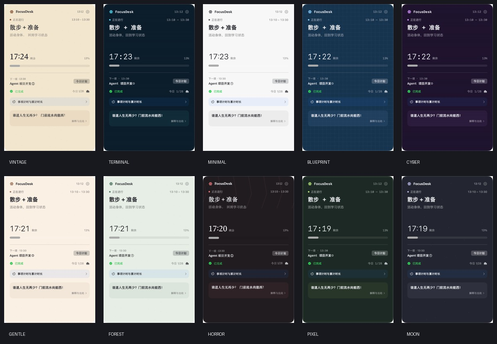
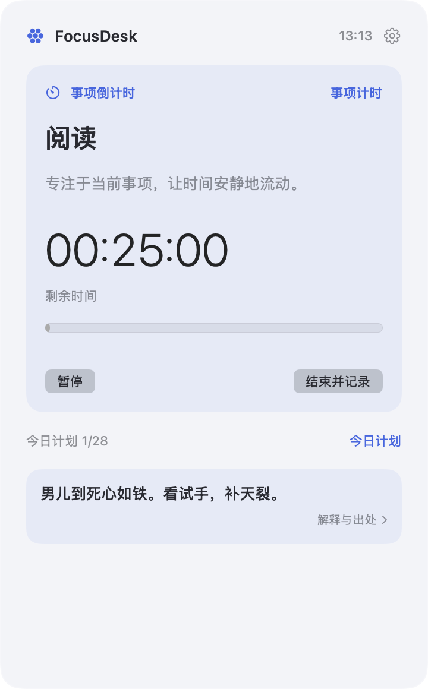
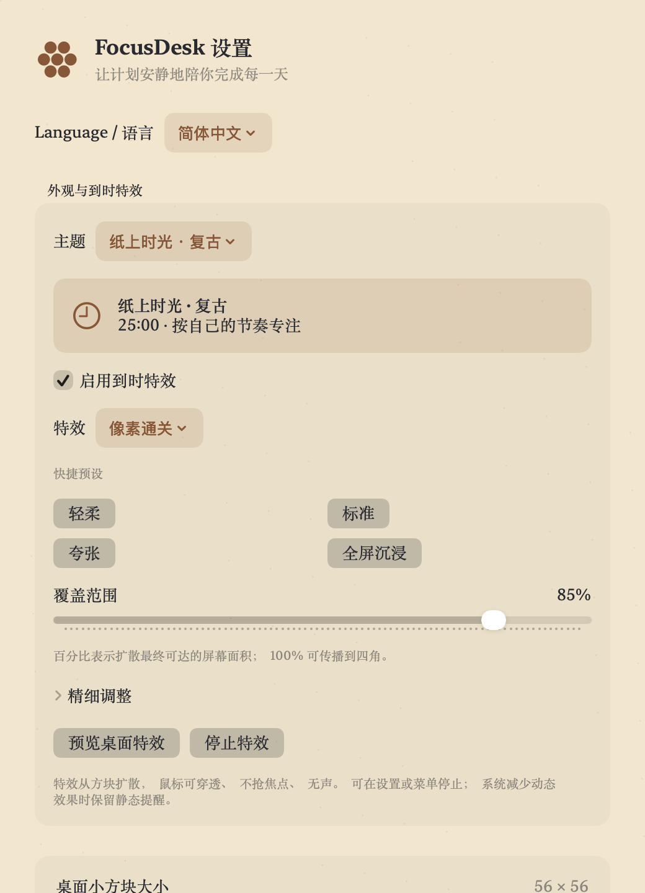
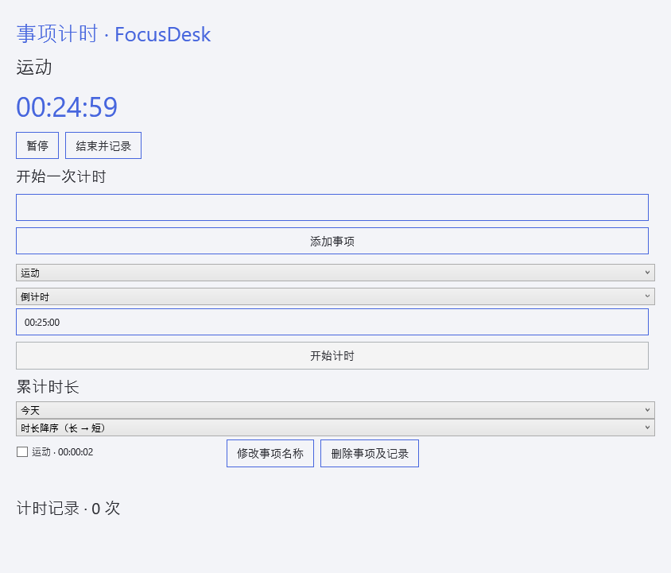
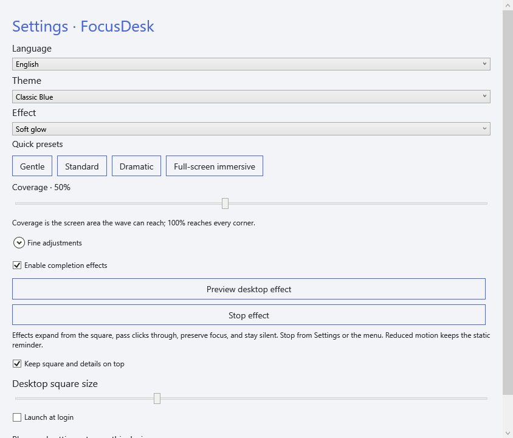
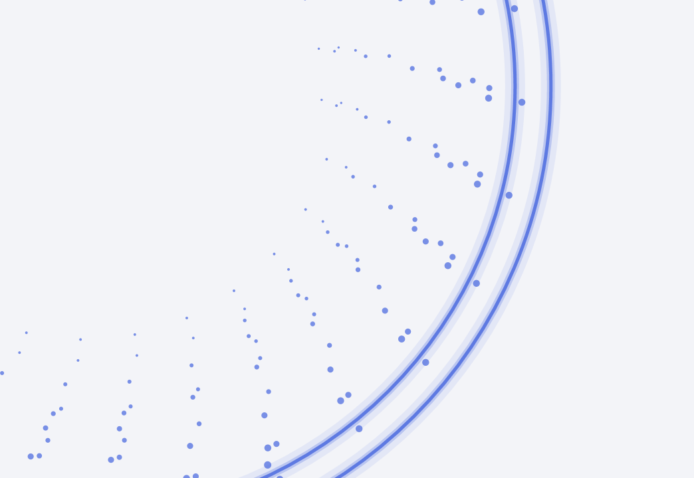

# FocusDesk

**简体中文** | [English](README.en.md)

跨 macOS 和 Windows 的本地专注桌面挂件：平时显示一个小方块，悬停展开当前计划或事项计时。计划、历史、计时、主题与语言设置均保存在当前设备，**没有账号、服务器或跨设备数据同步**。

[下载 Release](https://github.com/whathaventggood/FocusDesk/releases/latest) · [版本记录](CHANGELOG.md) · [安装说明](docs/INSTALL.md) · [发布说明](docs/RELEASING.md)

## 选择下载包

3.1.0 提供以下四个下载包。中文和英文包的功能完全相同，仅首次启动的默认语言不同；安装后可以在设置中切换语言。已有用户选择的语言与个人事项不会被安装包覆盖。

| 操作系统 | 默认简体中文 | 默认全英文 |
|---|---|---|
| macOS 13+，Apple Silicon | `FocusDesk-3.1.0-macos-arm64-zh-Hans.zip` | `FocusDesk-3.1.0-macos-arm64-en.zip` |
| Windows 10/11，x64 | `FocusDesk-3.1.0-windows-x64-zh-Hans.zip` | `FocusDesk-3.1.0-windows-x64-en.zip` |

请以 Release 页面实际附件及其检查结果为准。Windows 包自带 .NET 运行时，完整解压后打开 `FocusDesk.exe`，无需另装 .NET。Mac 包解压后把 `FocusDesk.app` 放入“应用程序”。升级前退出旧版，备份本地数据，再替换应用文件。Windows 请保留压缩包中所有文件，勿单独移动 EXE。

当前社区构建：Mac 使用本地临时签名，未经 Apple 公证；Windows 无商业代码签名。系统可能显示发布者验证提示，详情见安装说明。不要关闭系统安全防护。

## 桌面效果



| 桌面计时与到时状态 | 外观与特效设置 |
|---|---|
|  |  |

截图来自实际应用渲染；Windows 和英文截图见 [截图目录](docs/screenshots/)。

| Windows 中文版 | Windows English |
|---|---|
|  |  |

## 功能与一致性

| 功能 | macOS | Windows |
|---|---|---|
| 桌面方块、悬停展开、拖动缩放、置顶 | 支持 | 支持 |
| 每日重复计划、增删改、冲突确认替换 | 支持 | 支持 |
| 手动标记完成、按天保留历史 | 支持 | 支持 |
| 自定义事项、正计时、倒计时、暂停继续 | 支持 | 支持 |
| 到时保留、完成、+5 分钟、重启恢复 | 支持 | 支持 |
| 按事项累计、日期范围、排序、多选合计 | 支持 | 支持 |
| 11 套外观、10 种特效、屏幕范围与精细调整、预览 | 支持 | 支持 |
| 全英文 / 简体中文界面、示例与语录 | 支持 | 支持 |
| 系统入口 | 菜单栏、⌘1/2/3 | 系统托盘 |
| 计划编辑草稿、多级原位冲突预览 | 支持 | 对话框编辑及确认替换 |
| 历史筛选 | 7 / 30 天、全部 | 7 / 30 天、全部 |

两端共用 `shared/` 中的翻译、默认计划与语录。核心计时规则一致：暂停不计入、到点截断、等待处理不计入、睡眠和退出期间按实际时间恢复；“+5 分钟”从点击时新开一段计时，并累计至原事项。

用户自己输入的名称与说明不随语言切换翻译。默认示例仅在首次创建数据时按当前语言生成。更换语言不会重写已有计划。

### 使用方法

- **桌面方块**：默认 56 点，可调整为 32–112 点。鼠标移入展开详情，离开后自动收起；拖动移动，右下角调整大小。悬停不抢键盘焦点。
- **计划**：时间使用 `HH:mm`。结束 `00:00` 或 `24:00` 表示当天结束；跨午夜任务请拆为两段。新增冲突时先确认替换，保留原任务未覆盖的前后部分。
- **事项计时**：从菜单栏或托盘打开；每次一个计时。到时无声，保留“已到时”，主动完成后恢复每日计划。暂停或提前结束均可。
- **主题与特效**：设置中选主题、特效及四种预设，也可展开精细调整；可随时停止或关闭特效。动画窗口不接收点击、不抢焦点；遵循系统减少动态效果设置。桌面特效因平台绘图引擎而略有差异。
- **语言**：设置里的 `Language / 语言` 可随时切换；日期格式按界面语言和当地时间显示。
- **完成率**：手动完成任务数 ÷ 全部计划任务数，包含休息；时间流逝不会自动完成任务。无记录日期不补记。
- **退出**：关闭管理窗口后应用继续在菜单栏或托盘运行；通过菜单选择退出。

## 3.1 屏幕到时特效

| macOS · 85% | Windows · 85% |
|---|---|
|  |  |

- **四种快捷预设：**轻柔 15%、标准 50%、夸张 85%、全屏沉浸 100%。旧版强度设置会迁移到对应预设。
- **范围与浓度独立：**覆盖范围 10%–100%，按扩散圆与屏幕相交的实际面积计算；方块在角落也能达到对应范围。范围表示最终可达区域，不表示整块区域不透明。
- **精细调整：**视觉浓度、总时长 1–12 秒、扩散速度、1–3 波、粒子密度、边缘余光、背景压暗。所有设置自动保存。
- **三段动画：**方块起势、粗光带扩散与主题粒子、边缘余光。余光包含在总时长内，最多占 40%。
- **桌面实播：**预览使用真实屏幕范围；设置与菜单栏/托盘提供“停止特效”，关闭特效开关也会立即停止。
- **显示器：**默认仅方块所在屏幕；可开启所有显示器，其他屏幕从距方块最近的位置开始。无需屏幕录制权限。

macOS / Windows、中英文版使用一致的设置与预设，保持无声、鼠标穿透、不抢焦点，遵循系统减少动态效果。系统保护界面或独占全屏应用可能限制覆盖；多屏混合缩放仍需更多实机验证。

## 数据与隐私

| 系统 | 本地数据位置 |
|---|---|
| Mac | `~/Library/Application Support/FocusDesk/plan.json` 与 `timers.json`；偏好在应用 UserDefaults 中 |
| Windows | `%LOCALAPPDATA%\FocusDesk\desktop.json` |

两端使用适合各自平台的本地存储格式，不会自动互相导入或同步。保存先校验再原子替换；损坏文件备份后阻止覆盖。备份时先退出应用。Windows 默认语言文件 `default-language.txt` 只影响首次使用，不包含个人数据。

## 构建与验证

### Mac

```sh
python3 scripts/localization/generate.py
./scripts/test-xcode.sh
FOCUSDESK_DEFAULT_LANGUAGE=en ./scripts/build-app.sh Release
```

完整 XCTest 需要 Xcode 15+。本地仅有 Command Line Tools 时可执行 `scripts/check-core.sh`、`scripts/check-native.sh` 和 `scripts/build-app.sh`，这些不替代 XCTest。原生界面检查使用隔离数据，输出截图至 `build/native-smoke/`。

### Windows

使用 .NET 8 SDK，在 Windows 中运行：

```powershell
dotnet publish windows/FocusDesk.Windows -c Release -r win-x64 --self-contained true -o build/windows-publish
build/windows-publish/FocusDesk.exe --self-test
build/windows-publish/FocusDesk.exe --smoke
```

`--self-test` 检查计时、统计、回滚与损坏保护；`--smoke` 使用临时数据渲染双语界面和全部主题，输出 `build/windows-screenshots/`，不注册登录项或改动日常数据。

GitHub Actions 的 **Desktop parity** 在真实 macOS / Windows 运行器中测试和打包。Release 包只有在两端构建与检查成功后上传；附件包含 SHA-256。Windows 的自动界面渲染不等同于覆盖所有显卡、DPI、多显示器和真实鼠标交互，发布后仍欢迎提供设备反馈。

## 工程结构

- `FocusDesk/`：SwiftUI / AppKit 原生 Mac 应用。
- `windows/FocusDesk.Windows/`：WPF / .NET 8 原生 Windows 应用。
- `shared/`：共用中英文词条、默认任务、20 条语录。
- `scripts/localization/generate.py`：验证翻译覆盖与占位符，生成 Mac 翻译代码。
- `FocusDeskTests/`、`scripts/check-*.swift`：Mac 测试与隔离界面验收。
- `.github/workflows/`：双平台测试、构建与发布。

项目不包含手机版，也不提供个人数据的网络同步。
