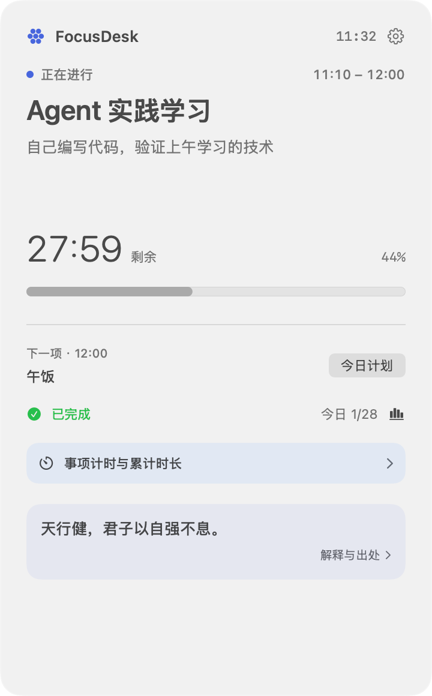
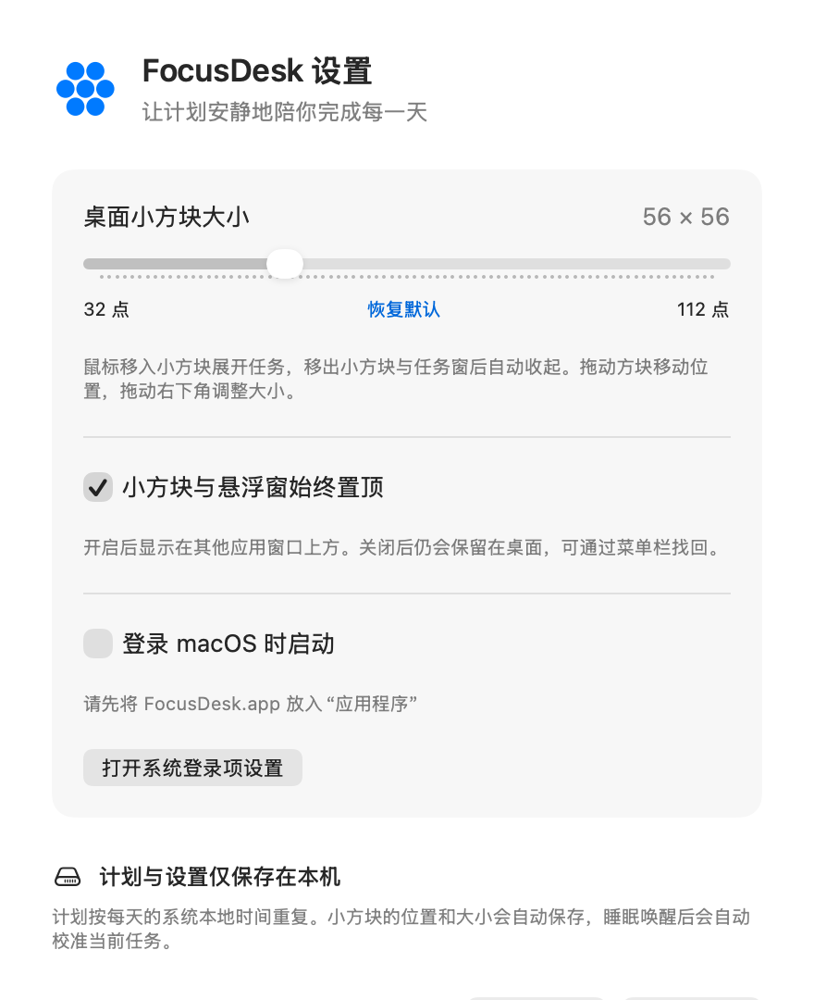

# FocusDesk

**简体中文** | [English](README.en.md)

面向 Apple Silicon Mac 的原生桌面专注计划应用，使用 Swift、SwiftUI、AppKit 和本地 JSON。最低系统为 macOS 13，不需要服务器、数据库或第三方依赖。

## 界面展示

### 桌面悬浮窗与设置

悬浮窗显示当前任务、剩余时间和下一项任务；设置中可调整置顶与登录启动。

| 桌面悬浮窗 | 设置 |
| :---: | :---: |
|  |  |

### 今日计划

按时间顺序浏览全天任务。点击任务卡片或铅笔图标，即可在原位置编辑，完成后立即保存并同步悬浮窗。


## 使用

- 启动后，悬浮窗默认出现在屏幕右上角；拖动空白区域可移动，位置会保存。
- 悬浮窗显示当前时间段、任务名称、详细说明、剩余时间、进度及下一项任务。没有任务时显示“自由时间”。
- 点击“今日计划”，在一个可滚动的窗口内浏览全天任务。点击任务卡片或铅笔图标后，卡片原位变成编辑表单；修改时间、名称和详细说明，点击“完成并保存”（⌘S）即保存到本地并同步悬浮窗。
- 同一窗口中可新增、删除任务。查看与编辑不切换页面，也不另开编辑窗口。
- 时间使用 `HH:mm` 24 小时制。结束时间必须晚于开始时间；结束时间 `00:00` 表示当天结束（24:00）。不能设置零时长、重叠时间段或空任务名称；相邻时间段允许共用边界。
- 计划是每天重复的作息表。首次启动包含需求中的 28 项默认任务，包括 `00:00–08:00` 睡眠及 `23:00–00:00` 睡前休息。
- 从菜单栏计时器图标可显示/隐藏悬浮窗、打开今日计划、打开设置或退出。应用不占用 Dock 图标，关闭计划窗口后仍在菜单栏运行。
- 设置中可开关“始终置顶”和“登录时启动”。悬浮窗不会主动成为键盘焦点；只有主动打开计划或设置窗口时，应用才激活。

计划按实际系统时间计算，不累计定时器次数。睡眠唤醒、日期变化、时区或系统时钟变化后会重新计算。全天任务按本地时间每日循环；未覆盖的时间段显示下一项任务（必要时为明日任务）。

## 从 Xcode 运行

1. 安装完整 Xcode 15 或更新版本，打开 `FocusDesk.xcodeproj`。
2. 选择 **FocusDesk** scheme，运行目标选择 **My Mac**。
3. 点击运行（⌘R）。本机开发如有签名提示，在 target 的 **Signing & Capabilities** 中选择自己的开发团队，或将本机签名设为 **Sign to Run Locally**。
4. 单元测试选择 **Product → Test**（⌘U）。共享 scheme 已包含 `FocusDeskTests`。

工程使用 Swift 5 语言模式，可由较新的 Swift 编译器构建；不使用 Swift Package 下载外部依赖。`Package.swift` 仅用于独立验证时间与校验逻辑，实际桌面应用应从 `.xcodeproj` 运行。

## 打包为 .app

### 完整 Xcode

在 Xcode 选择 **Product → Archive**，然后通过 Organizer 导出 macOS App；也可以在项目根目录运行：

```sh
mkdir -p build/tmp
TMPDIR="$PWD/build/tmp/" xcodebuild \
  -project FocusDesk.xcodeproj \
  -scheme FocusDesk \
  -configuration Release \
  -destination 'platform=macOS,arch=arm64' \
  -derivedDataPath "$PWD/build/DerivedData" \
  CLANG_MODULE_CACHE_PATH="$PWD/build/ModuleCache" \
  CODE_SIGN_IDENTITY=- build
```

产物为 `build/DerivedData/Build/Products/Release/FocusDesk.app`。本机自用可直接打开或复制到“应用程序”。面向其他用户分发时，应使用自己的 Developer ID 签名并进行公证。

### 只有 Command Line Tools

本仓库也提供直接调用系统 Swift 编译器的打包脚本，目标为 MacBook Air M1 使用的 arm64：

```sh
./scripts/build-app.sh Release
```

产物为 `build/Release/FocusDesk.app` 和 `build/Release/FocusDesk.zip`，已做本机临时签名并在打包前验证签名。ZIP 不包含 Finder 扩展属性，适合复制和保存。脚本只构建，不启动应用。需要调试构建时使用 `./scripts/build-app.sh Debug`。

本项目位于桌面同步目录；实测文件提供器会在签名后给 `.app` 自动重新附加 `com.apple.FinderInfo`，影响后续签名校验。遇到这一情况，请将生成的 `FocusDesk.zip` 解压到“应用程序”等非同步目录后运行。脚本只清理项目内生成物的扩展属性，不更改文件提供器或系统设置。

登录时启动由 macOS 的 `SMAppService.mainApp` 管理。建议先将 `.app` 放在固定的“应用程序”目录再开启；如果系统要求批准，请在 **系统设置 → 通用 → 登录项** 中允许 FocusDesk。构建本身不会修改登录项。

## 测试

测试覆盖任务时间匹配、边界和跨日下一项任务、剩余时间与进度、自由时间、时间输入格式、任务时段冲突及默认计划完整性。

有完整 Xcode 时：

```sh
mkdir -p build/tmp
TMPDIR="$PWD/build/tmp/" xcodebuild \
  -project FocusDesk.xcodeproj \
  -scheme FocusDesk \
  -configuration Debug \
  -destination 'platform=macOS,arch=arm64' \
  -derivedDataPath "$PWD/build/DerivedData" \
  CLANG_MODULE_CACHE_PATH="$PWD/build/ModuleCache" \
  CODE_SIGN_IDENTITY=- test
```

也可用 Swift Package 运行核心单元测试：

```sh
mkdir -p build/tmp
TMPDIR="$PWD/build/tmp/" \
CLANG_MODULE_CACHE_PATH="$PWD/build/ModuleCache" \
SWIFT_MODULECACHE_PATH="$PWD/build/ModuleCache" \
swift test --disable-sandbox \
  --scratch-path build/swift-test \
  --cache-path build/PackageCache \
  --config-path build/PackageConfig \
  --security-path build/PackageSecurity \
  --manifest-cache local
```

纯 Command Line Tools 安装可能不包含 XCTest；这种环境可以编译应用，但 `xcodebuild` 和 XCTest 测试需要安装完整 Xcode。不要把这一环境限制当作测试通过。

仅有 Command Line Tools 时，可运行不依赖 XCTest 的 Foundation 验证脚本：

```sh
bash scripts/check-core.sh
```

脚本直接编译应用使用的核心 Swift 文件，验证与单元测试对应的时间匹配、剩余时间、跨日及冲突等场景，缓存和产物均位于项目 `build/` 内。这是受限环境的逻辑验证，不能替代完整 Xcode 的 XCTest 与实际界面验收。共享 scheme 的测试环境会将数据隔离到项目 `build/XCTestData` 并使用内存偏好，避免覆盖日常计划。

原生窗口与持久化的隔离检查可运行 `bash scripts/check-native.sh`。脚本使用项目内测试数据及内存偏好，不启动日常使用的应用，也不注册登录项；在 `build/native-smoke/` 生成窗口预览图片。此检查需要正常桌面会话和 WindowServer 访问权限，受限沙箱可能拒绝执行。实际切换应用、拖动及睡眠唤醒行为仍需在正常启动后手动验收。

仅编译隔离检查、暂不创建窗口时，可用 `bash scripts/check-native.sh --build-only`。

### 本次验证（2026-10-21）

- Swift 6.3.3 以 Swift 5 模式成功编译 arm64 原生应用；Release `.app` 和无 Finder 元数据的 ZIP 打包成功。归档内容与应用文件一致，解包内容通过代码签名校验。
- Foundation 核心验证：20 个场景、124 项断言，0 失败。
- 隔离原生运行检查通过：启动悬浮窗不激活应用或夺取焦点、NSPanel 配置、显隐与置顶切换、计划及设置窗口复用、本地保存与重载、校验失败不写文件、删除、损坏 JSON 备份。三张窗口预览已目视检查。
- 已尝试 `xcodebuild build` 和 `xcodebuild test`；当前机器只有 Command Line Tools，缺少完整 Xcode 与 XCTest，未能执行 XCTest。上述 Foundation 与原生检查不冒充 XCTest 结果。
- 未操作日常登录项、跨应用手动拖动或真实睡眠唤醒；这些场景仍需用户在正常使用环境验收。

## 数据

首次实际启动时会创建：

```text
~/Library/Application Support/FocusDesk/plan.json
```

任务以 JSON 原子写入。窗口位置和置顶设置存入应用的 `UserDefaults`（bundle identifier 为 `com.focusdesk.FocusDesk`）；登录启动状态由 macOS 保存。重启应用会恢复计划、位置和设置。若 JSON 损坏，应用在同目录保留带时间戳的原文件备份并显示提示；无法备份时会阻止覆盖原文件。

开发时可通过环境变量 `FOCUSDESK_DATA_DIRECTORY` 指定计划 JSON 所在目录。此变量只覆盖计划路径，界面设置仍使用应用的 `UserDefaults`。构建和测试无需实际启动 GUI；仓库构建脚本将编译缓存及临时文件放在项目 `build/` 内。

## 工程结构

```text
FocusDesk/
  App/          应用入口、NSPanel、菜单栏及独立管理窗口
  Models/       任务模型、时间解析校验、默认计划
  Services/     时间匹配计算、本地持久化与系统设置
  Views/        悬浮窗、同窗原位编辑的计划列表、设置
  Resources/    Info.plist
FocusDeskTests/ XCTest 单元测试
FocusDesk.xcodeproj/
Package.swift   独立核心逻辑测试入口
scripts/        本机 .app 构建脚本
docs/screenshots/ README 界面截图
```
